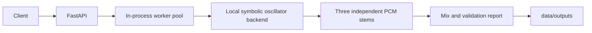

# Architecture

The initial implementation is a deterministic rule-based oscillator composer. It is not an AI music model, does not use a soundfont, and has no external provider configured. The provider interface is intentionally a contract until a real provider's official API and licensing are selected.
